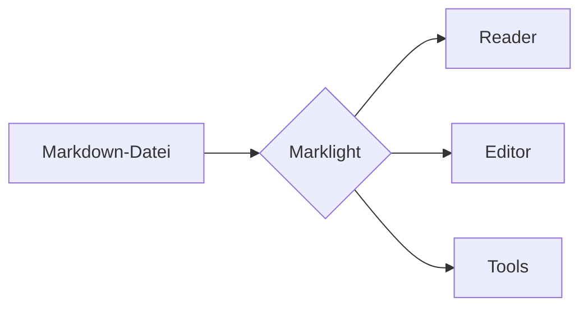

# Marklight-Demo

Willkommen! Dieses Dokument zeigt, was der **Marklight**-Reader alles darstellen kann. Nutze das Inhaltsverzeichnis links, wechsle das Design oben rechts oder starte den Präsentationsmodus, um diese Datei als Folien anzusehen.

## Textformatierung

Du kannst **fett**, *kursiv*, ~~durchgestrichen~~, `Inline-Code`, [Links](https://commonmark.org) und Tasten wie <kbd>Strg</kbd> + <kbd>K</kbd> schreiben. Auch Autolinks wie https://example.org funktionieren.

> Markdown soll so leicht lesbar und schreibbar wie möglich sein.
> — John Gruber

## Listen & Aufgaben

1. Datei, Ordner oder URL öffnen
2. Bequem lesen
   - mit Inhaltsverzeichnis
   - und Lesefortschritt
3. Teilen oder exportieren

- [x] Reader
- [x] Editor
- [x] Tools
- [ ] Dein Beitrag 😉

## Tabellen

| Funktion          | Reader | Editor | Tools |
| :---------------- | :----: | :----: | ----: |
| Live-Vorschau     |   —    |   ✅   |    ✅ |
| Formeln & Grafik  |   ✅   |   ✅   |     — |
| Export HTML/PDF   |   ✅   |   ✅   |    ✅ |

## Code

```js
// Alles läuft im Browser – nichts wird hochgeladen.
function gruss(name) {
  return `Hallo, ${name}!`;
}
console.log(gruss('Marklight'));
```

```php
<?php
declare(strict_types=1);
echo htmlspecialchars($eingabe, ENT_QUOTES, 'UTF-8');
```

## Hinweisboxen

> [!NOTE]
> Nützliche Information, die man kennen sollte.

> [!TIP]
> Zieh einen ganzen Ordner in den Reader, um deine Doku wie eine Website zu durchblättern.

> [!IMPORTANT]
> Der Server speichert deine Dokumente niemals.

> [!WARNING]
> Sehr lange Teilen-Links werden von manchen Messengern abgeschnitten.

> [!CAUTION]
> Wenn du die Browserdaten löschst, ist auch der Editor-Entwurf weg.

## Formeln

Inline wie $a^2 + b^2 = c^2$ oder abgesetzt:

$$
\int_{-\infty}^{\infty} e^{-x^2}\,dx = \sqrt{\pi}
$$

## Diagramme



## Fußnoten & Aufklappbereiche

Marklight unterstützt Fußnoten[^1] und aufklappbare Abschnitte.

<details>
<summary>Zum Aufklappen klicken</summary>

Versteckter Inhalt mit **Markdown** darin.

</details>

[^1]: So wie diese hier. Mit dem Pfeil springst du zurück.

---

*Engineered by EinfachDev.*
