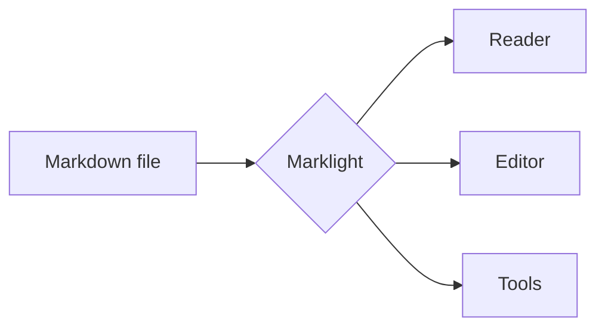

# Marklight demo

Welcome! This document shows what the **Marklight** reader can render. Use the table of contents on the left, switch themes with the button at the top right, or press the presentation button to view this file as slides.

## Text formatting

You can write **bold**, *italic*, ~~strikethrough~~, `inline code`, [links](https://commonmark.org) and <kbd>Ctrl</kbd> + <kbd>K</kbd> keys. Autolinks such as https://example.org work too.

> Markdown is intended to be as easy-to-read and easy-to-write as is feasible.
> — John Gruber

## Lists & tasks

1. Open a file, a folder or a URL
2. Read comfortably
   - with a table of contents
   - and reading progress
3. Share or export

- [x] Reader
- [x] Editor
- [x] Tools
- [ ] Your contribution 😉

## Tables

| Feature          | Reader | Editor | Tools |
| :--------------- | :----: | :----: | ----: |
| Live preview     |   —    |   ✅   |    ✅ |
| Math & diagrams  |   ✅   |   ✅   |     — |
| Export HTML/PDF  |   ✅   |   ✅   |    ✅ |

## Code

```js
// Everything runs in your browser – nothing is uploaded.
function greet(name) {
  return `Hello, ${name}!`;
}
console.log(greet('Marklight'));
```

```php
<?php
declare(strict_types=1);
echo htmlspecialchars($input, ENT_QUOTES, 'UTF-8');
```

## Alerts

> [!NOTE]
> Useful information that users should know.

> [!TIP]
> Drop a whole folder into the reader to browse your docs like a website.

> [!IMPORTANT]
> The server never stores your documents.

> [!WARNING]
> Very long share links can be truncated by some messengers.

> [!CAUTION]
> Clearing your browser data also removes the editor draft.

## Math

Inline math like $a^2 + b^2 = c^2$ and display math:

$$
\int_{-\infty}^{\infty} e^{-x^2}\,dx = \sqrt{\pi}
$$

## Diagrams



## Footnotes & details

Marklight supports footnotes[^1] and collapsible sections.

<details>
<summary>Click to expand</summary>

Hidden content with **Markdown** inside.

</details>

[^1]: Like this one. Click the arrow to jump back.

---

*Engineered by EinfachDev.*
